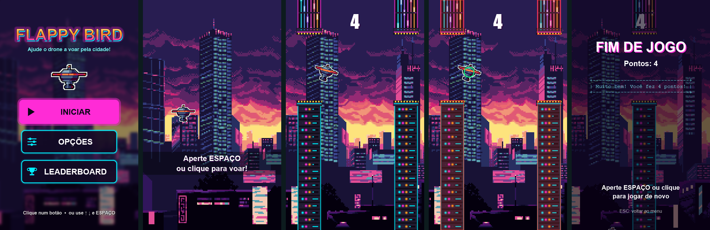
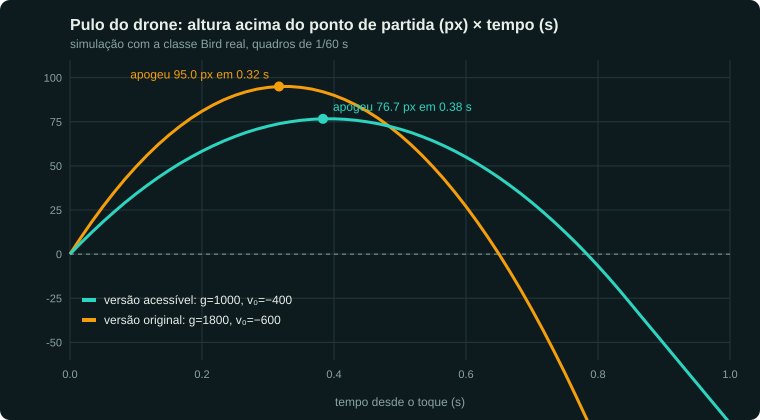
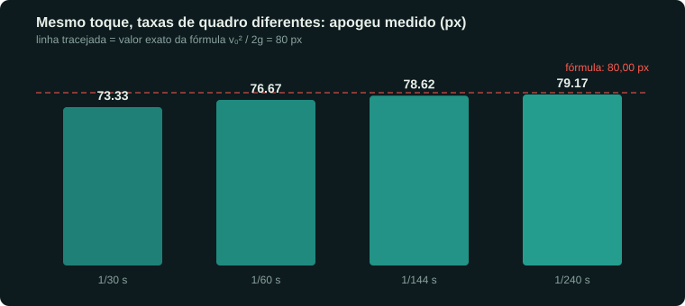
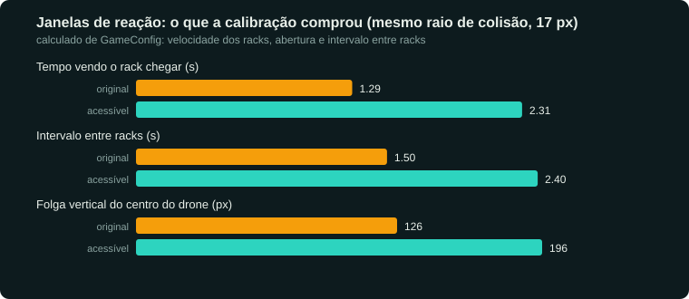
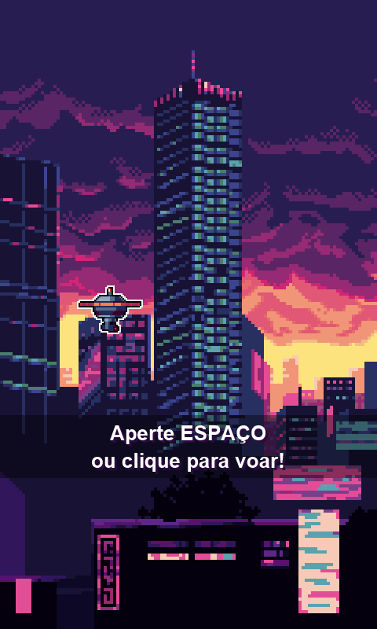
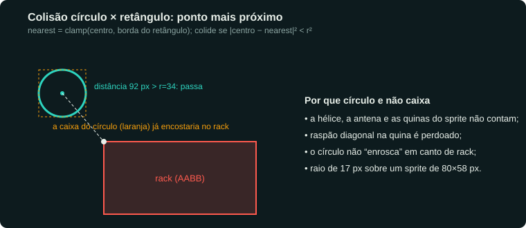
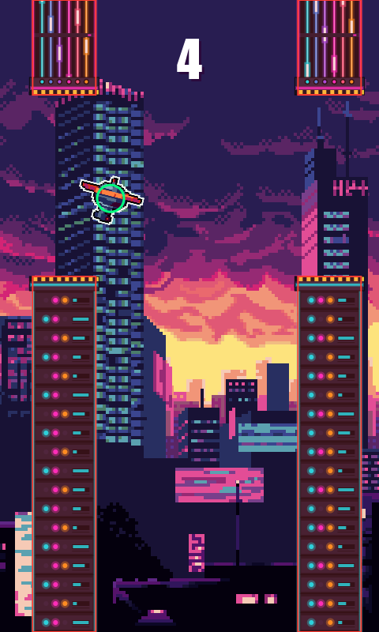
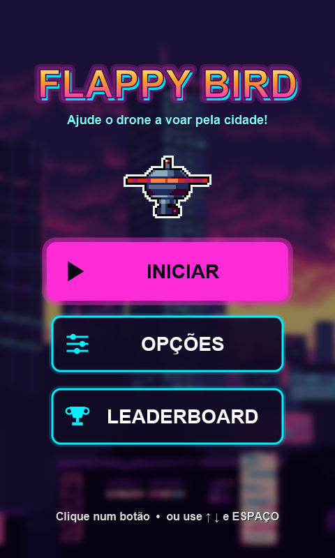
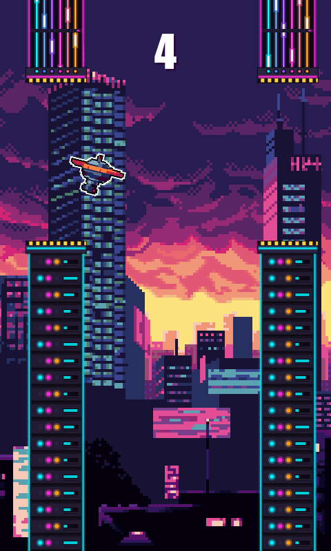
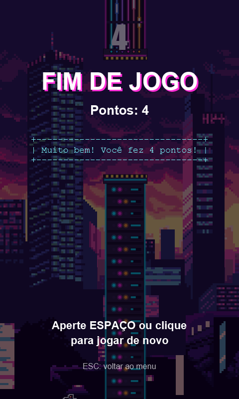

# Flappy Drone — jogo acessível para o projeto de extensão do SENAI

> **O código do jogo é fechado.** Este repositório é uma documentação pública de arquitetura e de decisões de engenharia, com foco em acessibilidade: o que foi construído, por que cada constante da física existe e o que foi medido. Os trechos de código citados são recortes, não o projeto.
> Os arquivos citados (`GameConfig.java`, `Bird.java`, `FlappyDrone.jar`…) pertencem ao repositório privado. Se você está avaliando meu trabalho e quer ver mais, é só pedir: berlofaspike@gmail.com.

> Estudo de caso. Java 17 + JavaFX 21 (Canvas), física escrita à mão, sem engine.
> Todos os números deste documento foram **medidos** rodando as classes reais do jogo ou **calculados** a partir de `GameConfig.java`. Onde algo não existe no código, está dito.
> Fonte: o repositório privado do projeto. As medições e os prints vieram do `FlappyDrone.jar`, o mesmo arquivo que vai no pendrive.



---

## 1. Por que este jogo existe (o ponto de partida)

O Flappy Drone nasceu como **projeto de extensão do SENAI**, com foco em **acessibilidade para pessoas com deficiência intelectual**, para ser levado a uma ONG num pendrive e jogado em projetor.

Isso mudou a pergunta de engenharia. Num Flappy Bird comum, a dificuldade é o produto. Aqui, **a dificuldade é o defeito**. O jogo só cumpre o objetivo se uma pessoa que reage mais devagar, ou que aperta a tecla sem saber exatamente quando, conseguir ter sucesso e se divertir.

Então a física deixou de ser "o que parece bom" e virou **parâmetro de projeto**: cada constante em `GameConfig` existe para comprar tempo de reação e margem de erro. O jogo é pequeno (13 classes, ~2 mil linhas). O que o torna um estudo de caso é a precisão dessa calibração e a forma de entrega.

O contexto não vive só na minha memória: o `GameConfig.java` chama o drone de "mascote SENAI" e o `pom.xml` explica que o mesmo `.jar` precisa rodar "no Windows da ONG" e no meu Linux.

> O que este documento **não** afirma: não há resultado de uso na ONG, nome de instituição, nem número de jogadores. Isso não está no repositório e não vou inventar. A seção 9 lista o que falta para fechar esse ciclo.

---

## 2. Arquitetura em uma tela

```
Launcher ─► Main (JavaFX Application, AnimationTimer, Canvas 480×800 escalado à janela)
              │
              ▼
        GameStateManager ── update(min(dt, 1/30)) ──► GameState (interface)
              │                                        ├─ MenuState
              │                                        └─ PlayState  (READY → PLAYING → GAME_OVER)
              ▼
   Bird · Pipe · Background · BoundingBox      AssetManager · AsciiArtService · GameConfig
```

| Peça | Papel |
|---|---|
| `GameState` + `GameStateManager` | padrão State: cada tela é um objeto com `update/render/handleInput/onEnter/onExit`. O gerenciador é o único que conhece o relógio. |
| `GameConfig` | **fonte única** de todas as constantes de física, tamanho e tolerância de entrada. Nada de número mágico espalhado. |
| `Bird` | posição vertical, velocidade, gravidade, rotação, animação, círculo de colisão. |
| `Pipe` | racks de servidor (cano), com dois `BoundingBox`. |
| `BoundingBox` | retângulo, interseção retângulo×retângulo e retângulo×círculo. |
| `AssetManager` | carrega imagens e sons; **se faltar algo, o jogo continua** (drone geométrico no lugar do sprite, sem som no lugar de som). |
| `AsciiArtService` | chama programas externos com **timeout de 2 s**; se não existirem, usa arte padrão. |

Resiliência é decisão de projeto, não enfeite. O jogo roda de pendrive, em máquina que não é minha, sem internet garantida e sem ninguém de TI por perto. Por isso:

- **Degrada em vez de cair.** Sem sprite → desenha o drone por código. Sem som → toca em silêncio. Sem as ferramentas ASCII → arte padrão. No log da captura deste estudo isso aparece de verdade: `'ponytail' não encontrado. Usando arte padrão.`
- **Nenhum código de rede no projeto.** Uma busca por `http`, `Socket` e `URL(` no código-fonte não retorna nada. O pendrive carrega só o `.jar` e o Java portátil.
- **Entrega sem instalação.** `jogar.bat` procura o Java na pasta `runtime\` ao lado do jogo, depois em `JAVA_HOME`, depois no `PATH`; confere a versão mínima (17) e, se faltar algo, mostra uma janela de aviso em vez de abrir e fechar sem explicar. Existe um `jogar_debug.bat` para diagnóstico. **F11** liga tela cheia para projetor.
- **Sem código no pendrive.** O projeto-fonte e a pasta do pendrive nunca se misturam (`1_PROJETO_JAVA` / `2_PENDRIVE_ONG`).

---

## 3. A física, do zero

Nenhuma biblioteca de física. O drone é uma posição vertical `y` e uma velocidade vertical `velocityY`; o mundo anda para a esquerda a `GROUND_SPEED`. O núcleo inteiro cabe em duas linhas de `Bird.update`:

```java
velocityY = Math.min(velocityY + GameConfig.GRAVITY * deltaTime, GameConfig.MAX_FALL_SPEED);
y += velocityY * deltaTime;
```

E o toque é só uma **troca de velocidade** (impulso), não uma força:

```java
public void jump() { if (!dead) { velocityY = GameConfig.JUMP_FORCE; rotation = JUMP_ROTATION; } }
```

### 3.1 O modelo

Com `g = GRAVITY = 1000 px/s²` e `v₀ = JUMP_FORCE = −400 px/s` (eixo y para baixo):

| Grandeza | Fórmula | Valor |
|---|---|---|
| Altura do pulo (apogeu) | `v₀² / 2g` | **80 px** |
| Tempo até o apogeu | `|v₀| / g` | **0,40 s** |
| Tempo até voltar à altura inicial | `2|v₀| / g` | **0,80 s** |
| Velocidade terminal | `MAX_FALL_SPEED` | **450 px/s**, atingida em **0,45 s** de queda (medido) |
| Distância caída até a terminal | `v² / 2g` | ≈ **101 px** |

O integrador é **Euler semi-implícito** (atualiza a velocidade e só depois a posição com a velocidade nova). É o mesmo que jogos de plataforma usam por ser estável e barato; a ordem das duas linhas importa.

### 3.2 Medido na classe real

Rodei a classe `Bird` do `FlappyDrone.jar` (sem janela, com o harness em [`docs/ferramentas/Shots.java`](docs/ferramentas/Shots.java)) e comparei com a versão anterior à calibração, cujos valores ficaram anotados nos comentários do `GameConfig` (`antes: 1800 / −600 / 800`):



| | original (`g=1800`, `v₀=−600`) | acessível (`g=1000`, `v₀=−400`) |
|---|---|---|
| Apogeu medido a 60 quadros/s | 95,0 px em 0,32 s | **76,7 px em 0,38 s** |
| Velocidade terminal | 800 px/s | **450 px/s** |

O pulo ficou **mais baixo e mais lento**: o drone sobe menos por toque, então um toque a mais ou a menos custa pouco. A queda é suave: a velocidade máxima caiu 44%.

### 3.3 O erro numérico (e por que eu aceito)

O apogeu medido (76,7 px) é menor que o exato (80 px). Não é bug: é o erro do passo de tempo. Medi o mesmo toque em quatro taxas de quadro:



```
dt=1/30   apogeu=73,33 px em 0,367 s; volta à altura inicial em 0,767 s
dt=1/60   apogeu=76,67 px em 0,383 s; volta à altura inicial em 0,783 s
dt=1/144  apogeu=78,62 px em 0,396 s; volta à altura inicial em 0,799 s
dt=1/240  apogeu=79,17 px em 0,396 s; volta à altura inicial em 0,796 s
```

Duas consequências, ditas sem rodeio:

1. **O pulo depende da taxa de quadro.** Em tela de 144 Hz o drone sobe ~2 px a mais do que em 60 Hz. O jogo **não** usa passo fixo (diferente do meu motor de luta, onde isso é regra).
2. **Eu aceito, e por números.** A variação total (73 a 79 px) é de ~6 px, contra **196 px de folga vertical** dentro da abertura (seção 4). Para este jogo, corrigir com passo fixo seria complexidade sem ganho perceptível. Se algum dia o jogo virar competitivo ou ganhar replay, o passo fixo vira obrigatório.

### 3.4 Proteção contra travada: o `dt` limitado

```java
currentState.update(Math.min(deltaTime, GameConfig.MAX_DELTA_TIME)); // 1/30 s
```

Se o computador travar por um instante (coletor de lixo, janela arrastada, projetor lento), o `dt` bruto poderia ser de meio segundo e o drone **atravessaria um rack de um quadro para o outro** (efeito túnel). Com o limite de 1/30 s, o jogo apenas **desacelera por um momento** e nunca teleporta. Num equipamento que não é meu e que eu não vou ver rodando, esse é o tipo de falha que o limite evita.

### 3.5 Geometria e transformações — o que existe de fato

Quero ser preciso aqui, porque "matemática" é fácil de exagerar.

- **Posição como vetor, movimento por integração.** O drone tem posição `(x, y)` com `x` fixo; os racks têm `x` decrescente a `GROUND_SPEED` (`x -= 140 * dt`). Todo o movimento do jogo é integração explícita de velocidade, escrita à mão.
- **Rotação do drone** (inclina −8° no toque e vai até +20° ao cair, a 60°/s) é aplicada com `gc.translate(x + w/2, y + h/2); gc.rotate(rotation)`. Isso gira o sprite **em torno do centro**: é a composição *mover-para-origem → rotacionar*, que o JavaFX resolve com a matriz de transformação afim do `GraphicsContext`. **Não escrevi uma classe de matriz**; escolhi a matriz do Canvas e a ordem certa das operações.
- **Trigonometria à mão** no drone geométrico de reserva: os dentes da engrenagem são calculados com `cos`/`sin` num bloco `static` (8 dentes × 4 vértices, uma vez só, sem alocar por quadro).
- **Colisão** é álgebra de vetores simples, na seção 5.

---

## 4. Calibrando a justiça: janelas de reação

Aqui a física vira acessibilidade. Cada constante abaixo foi mudada para **abrir uma janela**: tempo para ver, decidir e apertar, e margem para errar.

| Constante | Original | Acessível | O que compra |
|---|---|---|---|
| `GRAVITY` | 1800 | 1000 | queda lenta, mais tempo para decidir |
| `JUMP_FORCE` | −600 | −400 | pulo curto e controlável (~80 px) |
| `MAX_FALL_SPEED` | 800 | 450 | nunca cai "de repente" |
| `GROUND_SPEED` | 250 | 140 | racks 44% mais lentos |
| `PIPE_GAP` | 160 | 230 | abertura 44% maior |
| `PIPE_SPAWN_TIME` | 1,5 s | 2,4 s | 60% mais tempo entre racks (336 px de distância, contra 375 px antes) |

Efeito calculado a partir dessas constantes (raio de colisão fixado em 17 px nas duas colunas, só para isolar o efeito do que mudou):



| Janela | Original | Acessível |
|---|---|---|
| Tempo vendo o rack chegar até o drone | 1,29 s | **2,31 s** |
| Intervalo entre racks | 1,50 s | **2,40 s** |
| Folga vertical do centro do drone na abertura | 126 px | **196 px** |
| Tempo em que o rack "cruza" o corpo do drone | 0,46 s | **0,81 s** |

Contas: tempo de chegada = `(480 − (140 + 17)) / velocidade`; folga = `PIPE_GAP − 2·raio`; cruzamento = `(PIPE_WIDTH + 2·raio) / velocidade`.

**A pior transição possível está dentro do que dá para fazer com folga.** `PIPE_MAX_GAP_SHIFT = 140 px` limita o quanto uma abertura pode estar mais alta ou mais baixa que a anterior, e `PIPE_MIN_EDGE = 120 px` impede a abertura de encostar no teto ou no chão. No pior caso:

- **descer 140 px** em queda livre leva ≈ **0,54 s**;
- **subir 140 px** leva de 2 a 3 toques, na ordem de **0,5 s**;
- o intervalo entre racks é de **2,4 s**.

Ou seja, mesmo a transição mais difícil que o gerador pode produzir sobra mais de 4× de tempo. Ninguém cai por uma abertura "impossível".

**Referência, não medição.** O tempo de reação visual simples de um adulto fica na casa de 250 ms (valor de literatura geral, não medido por mim). A janela de 2,3 s é quase 10× isso. Eu **não** testei com o público-alvo; a calibração é uma margem de segurança por construção, e o ajuste fino com a ONG é o próximo passo natural (seção 9).

### 4.1 Tolerâncias de entrada

Pequenas decisões que existem pelo mesmo motivo:

- `GAME_OVER_INPUT_DELAY = 1,0 s`: depois de perder, a tela de fim **ignora toques por 1 s**. Quem está apertando a tecla sem parar não "pula" o resultado sem ler.
- `STATE_INPUT_DELAY = 0,35 s`: pausa curta ao entrar no menu ou numa partida nova; evita que o clique anterior "vaze" para a tela seguinte.
- **O teto não mata.** Encostar no topo só segura o drone (`y = 0`, velocidade zerada). Quem aperta demais não perde por isso.
- **Fase "Prepare-se".** O jogo só começa no primeiro toque; o drone flutua sem gravidade antes disso.
- **Pontuação justa:** o ponto conta quando o rack passou **inteiro** pelo corpo do drone, não pela ponta do sprite.



---

## 5. Colisão: círculo contra retângulo

O sprite tem 80×58 px, mas a hélice, a antena e as quinas da caixa **não devem matar**. Então o corpo de colisão é um **círculo de 17 px** sobre o corpo do drone (`BIRD_HITBOX_RADIUS`), deslocado 2 px para baixo (`BIRD_HITBOX_OFFSET_Y`).

O teste círculo × retângulo acha o ponto do retângulo mais próximo do centro (um *clamp* por eixo) e compara a distância ao quadrado com o raio ao quadrado:

```java
double nearestX = Math.max(x, Math.min(centerX, x + width));
double nearestY = Math.max(y, Math.min(centerY, y + height));
double dx = centerX - nearestX, dy = centerY - nearestY;
return dx * dx + dy * dy < radius * radius;
```



Sem raiz quadrada (compara quadrados). Nas quinas, o círculo precisa **realmente encostar**; a caixa do círculo encostaria antes e puniria raspões diagonais.

A captura abaixo foi gerada com o **jogo real**: o círculo verde é o `getHitCenterX/Y/Radius` do drone e os retângulos vermelhos são os `topBounds`/`bottomBounds` privados de cada `Pipe` (lidos por reflexão só na ferramenta de captura; o jogo não foi alterado).



`GameConfig.DEBUG_HITBOX` liga esse círculo dentro do próprio jogo, para conferir se o encaixe está justo. Fica `false` na versão final.

---

## 6. Telas

| Menu | Jogando | Fim de jogo |
|---|---|---|
|  |  |  |

- **Menu** com fundo desfocado (`GaussianBlur` de 14 px) e botões grandes, de alto contraste (rosa neon sobre fundo escuro), pensados para leitura à distância no projetor.
- **Fundo em paralaxe** de três camadas: a mais próxima anda a 25% da velocidade dos racks, as outras ainda mais devagar. É profundidade sem custo e **sem confundir** o que é obstáculo.
- **Fim de jogo** com texto grande e mensagem de incentivo (`"Muito bem! Você fez 4 pontos!"`), sem linguagem de derrota.

> Os botões **OPÇÕES** e **LEADERBOARD** do menu hoje mostram o aviso "em breve!". São pontos de extensão deixados no código, não funcionalidades prontas.

---

## 7. Como reproduzir os números

Precisa do `FlappyDrone.jar`, que não está neste repositório. Os resultados já medidos estão em [`docs/ferramentas`](docs/ferramentas) (`fisica.txt` e `trajetoria.csv`).

Tudo em [`docs/ferramentas`](docs/ferramentas):

- `Shots.java` — abre as classes reais (`MenuState`, `PlayState`, `Bird`, `Pipe`) a partir do `FlappyDrone.jar`, sem janela, salva os prints e mede a física (`fisica.txt`, `trajetoria.csv`). Um piloto automático simples aperta o espaço só para chegar a quatro pontos e gerar as imagens de jogo.
- `charts.py` — gera os gráficos SVG a partir dos CSVs e monta a folha de prints.

```
javac -cp FlappyDrone.jar -d cls docs/ferramentas/Shots.java
java  -cp "cls;FlappyDrone.jar" com.example.flap_bird_proj_extensao.Shots docs/img docs/ferramentas
python docs/ferramentas/charts.py
```

O `Shots.java` declara o mesmo pacote do jogo e lê campos privados (`score`, `pipes`, `topBounds`…) por reflexão, só na ferramenta; o código do jogo não é alterado.

---

## 8. O que eu faria diferente

1. **Passo fixo de física** (`acumulador / 1/60 s`) para o pulo ser idêntico em qualquer taxa de quadro. Hoje a variação (73–79 px) é irrelevante para o público-alvo, mas é uma dívida consciente.
2. **Testes automatizados** da física e da colisão. Hoje a verificação é manual e por captura; o harness deste estudo é um começo, mas não é uma suíte.
3. **Dificuldade como dado**, não como constantes `static final`: um arquivo de perfil (leve / médio / normal) que a pessoa responsável escolhe antes de jogar, sem recompilar. É a mesma ideia do perfil de dificuldade do bot no meu jogo de luta.
4. **Modo de um botão só**, com o drone subindo sozinho enquanto a tecla está pressionada, para quem tem dificuldade com o *timing* do toque.

---

## 9. O que falta para fechar o ciclo com a ONG

- Registrar **quem testou**, quanto tempo e o que mudou depois (nada disso está no repositório, então não está neste documento).
- Ajustar as constantes com observação real: o `GameConfig` foi desenhado para isso. Mudar uma linha muda a experiência.
- Implementar o que o menu promete (opções e placar) ou removê-lo.

---

## Ficha técnica

| | |
|---|---|
| Linguagem / UI | Java 17 (`maven.compiler.release=17`), JavaFX 21.0.5, Canvas |
| Build | Maven (wrapper incluso), `maven-shade-plugin` → `FlappyDrone.jar` com JavaFX de Windows e Linux dentro |
| Entrega | pasta `FlappyDrone/` com `.jar`, Java portátil em `runtime/`, `jogar.bat`, `jogar.sh`, `jogar_debug.bat`, `LEIA-ME.txt` |
| Classes | 13 (`Main`, `Launcher`, `GameConfig`, `GameState`, `GameStateManager`, `MenuState`, `PlayState`, `Bird`, `Pipe`, `Background`, `BoundingBox`, `AssetManager`, `AsciiArtService`) |
| Arte | sprite "Drone 1" do pacote da CraftPix; `ferramentas/preparar_assets.py` prepara as tiras de sprite |
| Física | Euler semi-implícito, `dt` limitado a 1/30 s, sem passo fixo |
| Colisão | círculo (17 px) × AABB, sem raiz quadrada |
